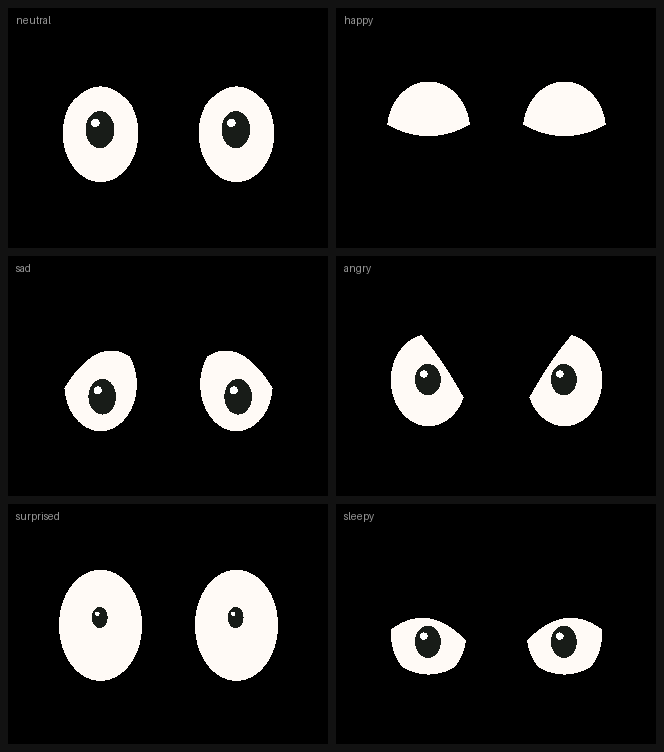

# Virtual AI Keychain

A small, expressive companion keychain: animated eyes, my voice, our photos, and
a cloud AI that answers questions when there is internet - while everything
personal keeps working offline.

Building it step by step, starting **without buying any hardware**.

**Current status: Phase 1 done** - the animated face runs in the Wokwi simulator.


*Recorded from the real animation code: idle glances, a poke (surprised →
delighted), each expression, falling asleep and waking up.*

| | |
|---|---|
|  | The six expressions, rendered by the same code that drives the display. |

---

## Try it now (no hardware, no cost)

1. Open **<https://wokwi.com/projects/new/esp32-s3>**.
2. Paste `firmware/keychain-eyes/diagram.json` into the **diagram.json** tab.
3. Add the libraries **Adafruit GFX Library** and **Adafruit ILI9341**.
4. Paste `firmware/keychain-eyes/sketch.ino` into **sketch.ino**, then create a
   new file called `eye_engine.h` and paste `firmware/keychain-eyes/eye_engine.h`.
5. Press ▶ **Play**. Click the green button to change expression, the blue one to
   poke the face, or hold the green one to put it to sleep.

The full walkthrough, with wiring tables and troubleshooting, is in
**[docs/01-wokwi-step-by-step.md](docs/01-wokwi-step-by-step.md)**.

### Or run the face on your Mac

```bash
cd tools/preview
make          # needs g++ (Xcode Command Line Tools) - nothing else
make gif      # renders docs/preview.gif  (this step also needs Pillow)
```

The preview compiles the **same** `eye_engine.h` that runs on the ESP32, so you
can tune expressions in seconds instead of waiting for a simulator reload.

---

## What is in the repository

```
firmware/keychain-eyes/     the Wokwi project (paste into wokwi.com)
  sketch.ino                hardware: TFT, buttons, main loop
  eye_engine.h              the animation engine - no hardware code at all
  diagram.json              wiring for the simulator
  libraries.txt             libraries Wokwi should install
  wokwi.toml                only needed for the VS Code / CLI version of Wokwi
tools/preview/              renders the face on a Mac, and builds the docs images
docs/                       step-by-step guide, design notes, images
```

Start reading in this order: the Wokwi guide → `eye_engine.h` (the comments at
the top explain the whole idea) → `docs/02-how-the-eyes-work.md`.

---

## Design decisions so far

**A colour IPS TFT, not the OLED from the reference keychain.** The 128x64
monochrome OLED is perfect for eyes but useless for photos, and photos are a
core feature. The current layout is a 320x240 landscape colour TFT (an ILI9341
module in the simulator). The final device will probably use a 1.3"-2.0"
240x240 / 240x320 IPS panel with an ST7789 controller - the code does not care,
`Face::begin(screenW, screenH, seed)` adapts the eye layout to whatever screen
you give it.

**No framebuffer.** A full 320x240 frame is 150 KB; drawing straight to the
display with clipped vertical lines is both smaller and flicker-free. See
`docs/02-how-the-eyes-work.md`.

**Offline first.** Eyes, buttons and (later) voice notes and photos must never
depend on WiFi. The cloud AI is an optional layer on top, never the foundation.

**Springs, not keyframes.** Every expression change is a physical animation, so
new expressions need no hand-authored frames - just twelve numbers.

---

## Roadmap

| Phase | What | Status |
|---|---|---|
| 1 | Animated face: blinking, glances, 6 expressions, sleep | **done** |
| 2 | Interaction: button-driven states, reactions, idle/sleep behaviour | next |
| 3 | Photo gallery on a colour display | later |
| 4 | Voice messages (needs real audio hardware) | later |
| 5 | Cloud AI with mocked responses first | later |
| 6 | Putting it all together with offline fallbacks | later |
| 7 | Physical prototype (display, battery, enclosure, sealing) | much later |

### What Wokwi can and cannot show

Wokwi's ESP32-S3 simulation covers GPIO, SPI displays, WiFi and PSRAM, so
Phases 1, 2, 3 and 5 can be developed there. Two things it **cannot** do:

* **I2S audio** - not implemented for the ESP32-S3 yet, so microphone input and
  speaker output (Phase 4) will need real hardware, or an audio layer that is
  mocked out and swapped in later.
* Real-world timing, battery life, wireless charging, enclosure fit and water
  resistance - all Phase 7.

---

## A note on the reference projects

The three projects in `Youtube-2-main.zip` (123_Keychain, 124_Video_Player,
126_PuzzleBox) were used as **design references only** - the expression set and
the general approach. No code from them has been copied into this repository,
which matters because their licences (and the licences of their dependencies)
have to be checked before any of it is redistributed. Everything here was written
from scratch. If you do want to reuse a snippet later, check that project's
licence first and note it here.
